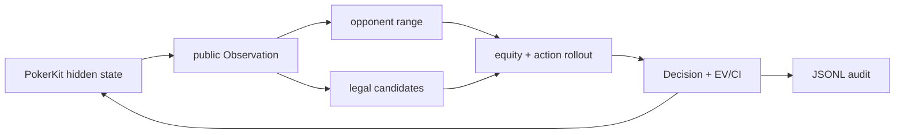

# Poker AI MVP

첨부 설계안을 실행 가능한 첫 버전으로 옮긴 **오프라인 연습용 2인 노리밋
텍사스 홀덤 AI**입니다. 각 핸드는 100BB에서 시작하며 PokerKit 0.7.7이
규칙, 합법 베팅 범위, 런아웃, 팟과 칩 정산을 담당합니다.

정책에 전달되는 경계는 항상 `Observation -> Decision`입니다.
`Observation`에는 내 패와 공개 정보만 있고 상대 패와 남은 덱은 구조적으로
들어갈 수 없습니다.

## 현재 구현된 범위

- 상대 1~9명의 몬테카를로 승률·무승부·에쿼티와 95% 신뢰구간
- 균등/가중 상대 레인지, 카드 블로커 제거, 관측 행동에 따른 베이지안 갱신
- 체크·콜·폴드·최소/0.5팟/1팟/올인 `raise_to` 후보 생성
- 행동별 순칩 EV와 불확실성 비교
- PokerKit 기반 2인 100BB 한 핸드 자동 진행 및 정확한 정산
- tight/calling/aggressive/balanced/random 기준 상대
- 모든 판단의 JSON/JSONL 감사 로그와 PokerKit PHH 재생 기록
- 좌석을 번갈아 평가하는 bb/100 및 95% 신뢰구간 보고
- 확장 전 학습 파이프라인 검증용 Kuhn poker CFR
- 화면 입력용 타입 경계(실제 화면 캡처/클릭은 의도적으로 미구현)



## 설치

Python 3.11 이상이 필요합니다.

```bash
cd pokerai-Demo
python3.11 -m venv .venv
.venv/bin/python -m pip install -e '.[test]'
```

## 빠른 사용법

### 1. 에쿼티 계산

```bash
.venv/bin/poker-ai equity \
  --hero As Qs \
  --board Jh 7d 2c \
  --opponents 1 \
  --simulations 10000 \
  --seed 42
```

결과에는 단독 승률, 무승부율, 패배율, 팟 분할을 반영한 에쿼티, 95%
신뢰구간과 재현용 시드가 따로 나옵니다.

### 2. 한 의사결정 비교

입력 금액은 모두 정수 칩이며 `100칩 = 1BB`입니다. 레이즈는 추가 금액이
아닌 **현재 스트리트의 총 `raise_to`**입니다.

```bash
.venv/bin/poker-ai advise \
  --hero As Qs \
  --board Jh 7d 2c \
  --pot 3000 \
  --call-cost 1000 \
  --hero-stack 9000 \
  --villain-stack 8000 \
  --hero-contribution 0 \
  --villain-contribution 1000 \
  --min-raise-to 2000 \
  --max-raise-to 9000 \
  --opponent calling \
  --simulations 10000 \
  --rollouts 2000 \
  --hero-policy-master-seed 42 \
  --audit decisions.jsonl
```

출력은 선택한 행동만이 아니라 모든 후보의 평균 EV, 신뢰구간, 선택 점수,
에쿼티, 모델/레인지 버전, 계산 시간과 시드를 포함합니다.

### 3. 한 핸드 자동 플레이

```bash
.venv/bin/poker-ai play \
  --hero-index 1 \
  --opponent aggressive \
  --environment-master-seed 17 \
  --hero-policy-master-seed 18 \
  --villain-policy-master-seed 19 \
  --simulations 2000 \
  --audit hand-decisions.jsonl
```

간단한 결과만 보려면 `--compact`를 추가합니다. 전체 출력에는 PokerKit PHH
기록이 포함되어 동일한 핸드와 행동을 다시 검사할 수 있습니다.

### 4. 기준선 상대 평가

```bash
.venv/bin/poker-ai evaluate \
  --hands 100 \
  --opponent calling \
  --environment-master-seed 1000 \
  --hero-policy-master-seed 2000 \
  --villain-policy-master-seed 3000 \
  --simulations 1000
```

환경·hero 정책·villain 정책 난수는 서로 다른 마스터 시드에서 파생합니다.
같은 덱 시드를 두 좌석에 번갈아 배정하고, 평균 핸드 수익과 bb/100에 95%
신뢰구간을 붙입니다. 적은 핸드의 bb/100은 변동성이 매우 크므로 성능 결론을
내리기보다 파이프라인 점검용으로 사용해야 합니다.

### 5. 작은 게임에서 CFR 검증

```bash
.venv/bin/poker-ai train-kuhn --iterations 10000
```

## 테스트

```bash
.venv/bin/python -m pytest
```

테스트는 다음을 포함합니다.

- 잘못된 카드와 카드 중복 거부, 휠 스트레이트/키커/무승부 평가
- 고정 시드 재현, 가중 레인지 샘플링, 1~9인 팟 분할
- 같은 공개 관측에서 숨은 상대 패가 정책 입력에 나타나지 않는지 확인
- PokerKit 합법 레이즈 범위, 잘못된 액션의 원자적 거부
- 폴드·올인 자동 런아웃, 칩 보존과 제로섬 정산
- JSON 직렬화/JSONL 기록, 전체 한 핸드와 소규모 매치 통합 실행

## 구조

| 파일 | 책임 |
|---|---|
| `environment.py` | PokerKit 게임 상태, 진행, 정산, 공개 관측 생성 |
| `observation.py` | 숨은 정보가 없는 불변 입력 DTO |
| `equity.py` | 승/무/패와 split-pot 에쿼티 몬테카를로 |
| `ranges.py` | 상대 패 확률분포와 베이지안 갱신 |
| `actions.py` | 합법 행동 추상화와 `raise_to` 크기 |
| `rollout.py` | 상대 폴드/콜과 쇼다운의 공개정보 롤아웃 |
| `policy.py` | 행동별 EV·CI 비교와 최종 선택 |
| `agent.py` | 레인지·에쿼티·정책·감사 로그 연결 |
| `simulation.py` | 한 핸드 및 기준선 매치 오케스트레이션 |
| `evaluate.py` | bb/100과 95% 신뢰구간 |
| `train.py` | Kuhn poker CFR 검증 구현 |
| `screen_adapter.py` | 향후 허용된 연습 화면 입력용 프로토콜 |

## 중요한 한계

- 현재 액션 롤아웃은 상대의 즉시 폴드/콜과 에쿼티 기반 쇼다운을 표본화하는
  명시적 기준선입니다. 전체 미래 베팅 트리를 푸는 MCCFR 정책은 아닙니다.
- 가중 레인지는 현재 헤즈업 계산에 적용됩니다. 다인 에쿼티는 균등 범위에서
  카드 중복 없이 공동 샘플링합니다.
- `screen_adapter.py`는 인터페이스만 제공합니다. 온라인 포커 화면 인식,
  자동 클릭, 실시간 보조 기능은 포함하지 않습니다.
- 실제 서비스에서 이런 도구를 쓰면 서비스 약관 또는 관할 법률을 위반할 수
  있습니다. 이 프로젝트는 허용된 오프라인 연습·연구 환경에서만 사용하세요.

PokerKit API는 [공식 문서](https://pokerkit.readthedocs.io/en/stable/)를
기준으로 고정했습니다.
